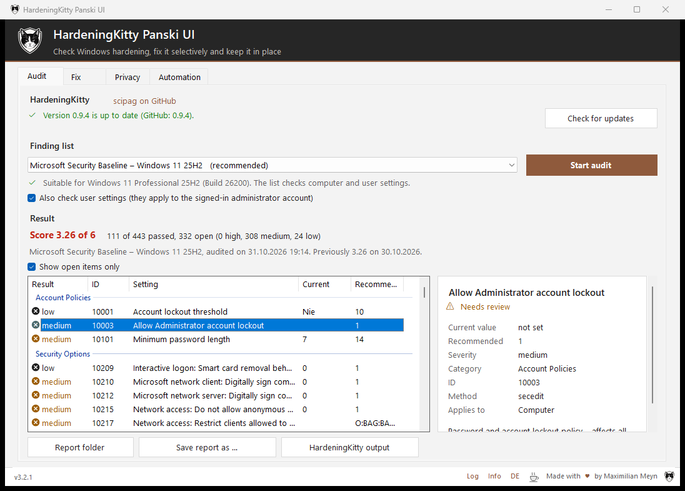
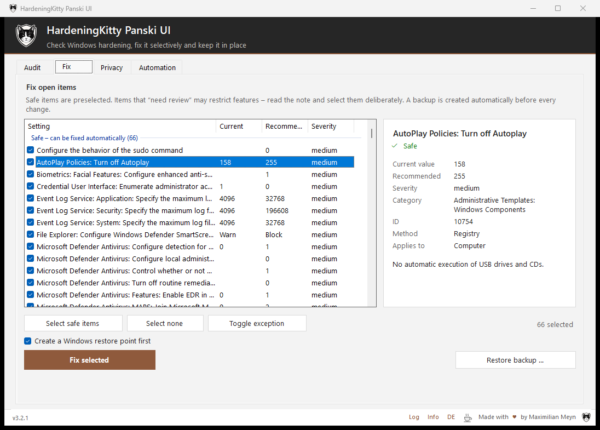
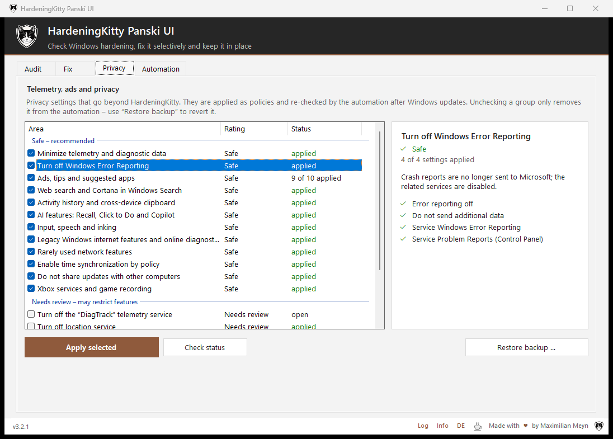
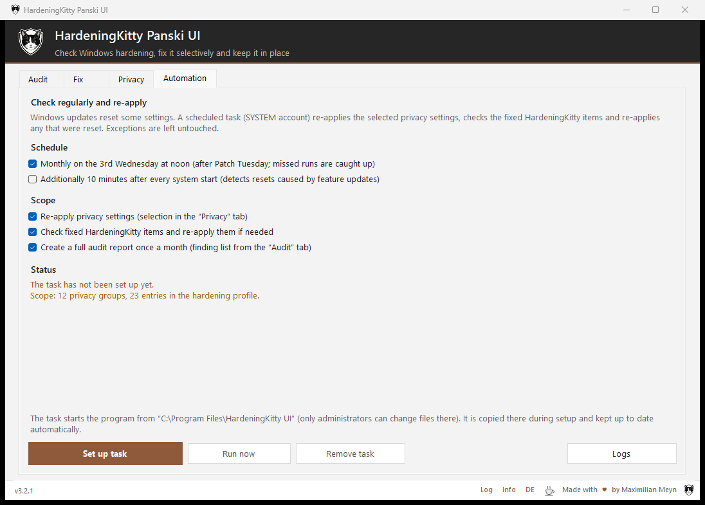

# HardeningKitty Panski UI

A Windows GUI for [HardeningKitty](https://github.com/scipag/HardeningKitty) by scip AG.
It checks Windows hardening, classifies open findings, fixes them selectively, and can roll the changes back.

[](../../releases/latest)


[](LICENSE)

> Dedicated to Panski † – *Gewidmet Panski †*

> **Note:** This is an independent community project. It is not affiliated with, endorsed by or supported by
> scip AG or the HardeningKitty project. Please report issues with this UI here, not to HardeningKitty.



## Features

- **Audit:** HardeningKitty audit with the matching finding list for your OS, score, history and CSV export.
  On request, HardeningKitty is downloaded from its official GitHub releases and its Authenticode signature (scip AG) is verified.
- **Fix:** Apply findings by classification (safe, needs review, manual). A restore point is created before
  any change, and a backup can be restored.
- **Privacy:** 18 groups covering registry policies, services and scheduled tasks, with backup, check and restore.
- **Automation:** a scheduled task running as SYSTEM (by default on the 3rd Wednesday at 12:00), also runnable via `/auto`.
- German and English UI, switchable at runtime.

## How it uses HardeningKitty

The UI does not replace or modify HardeningKitty. It is a front end that calls the original PowerShell module.

- HardeningKitty is **not bundled** with the EXE. The UI downloads a release of
  [scipag/HardeningKitty](https://github.com/scipag/HardeningKitty) (tag archive from GitHub) into its own program folder.
  It requires a valid Authenticode signature by scip AG on `HardeningKitty.psm1` (otherwise nothing is installed) and keeps the files unchanged,
  including the original `LICENSE` and `README.md`.
- **Audit** runs `Invoke-HardeningKitty -Mode Audit` with the unchanged finding lists. The score is calculated the same way as in HardeningKitty.
- **Fix** writes a subset of the selected finding list (selected rows only, copied unchanged) and passes it to
  `Invoke-HardeningKitty -Mode HailMary` (with `-AllowCustomList` from HardeningKitty 0.9.4 on).
  Before that, the UI creates its own backup of the affected settings and, optionally, a restore point.
- Items that HailMary cannot apply as intended (for example checks with operators such as `!=` or `contains`) are marked *manual*.
- The **Privacy** groups are a separate addition by this UI and are not part of HardeningKitty.

## Screenshots

### Audit

Pick a finding list (the one matching your Windows version is preselected), run the audit and see the score.
Click an item to see all details on the right (see the screenshot at the top).

### Fix

Open items are grouped into *safe*, *needs review* and *manual*. Safe items are preselected.
A backup and (optionally) a Windows restore point are created before anything is changed.
Items you deliberately do not want hardened can be marked as an exception.



### Privacy

Telemetry, ads and privacy settings that go beyond HardeningKitty, applied as policies.
Each group shows its individual settings and their current status.



### Automation

Windows updates reset some settings. A scheduled task re-applies the selected privacy settings,
re-checks the fixed HardeningKitty items and can create a full audit report once a month.



## Download

The current executable is available under **[Releases](../../releases/latest)**.
Download `HardeningKittyUI.exe`, put it in a folder of its own and start it. It asks for administrator rights.
The program keeps its settings, reports, logs and backups in subfolders next to the EXE.

The SHA-256 checksum of each release is listed in the release notes. To verify it:

```bat
certutil -hashfile HardeningKittyUI.exe SHA256
```

## Important notes

- The application needs **administrator rights** and **changes system settings**. Audit, fix, privacy changes, restore and
  automation have been tested on Windows 11 (25H2). Hardening can still break things on your particular system, so keep
  the restore point and backup enabled and, ideally, try it in a VM or test environment first.
- The EXE is **not signed**. Windows SmartScreen may show "Windows protected your PC" – click *More info* → *Run anyway*.
  Antivirus software may also warn about it.
- The UI was built for personal use. You are free to fork and adapt it.

## Build it yourself

Requirements: Windows with the .NET Framework 4.x that ships with it (no Visual Studio needed).

```bat
cd Quellcode
build.cmd
```

The EXE is written to `Programm\HardeningKittyUI.exe`. `build.cmd` fails if the EXE is currently running.

Icons and images are already in the repo (`app.ico`, `Quellcode\Bilder\*.png`). `Bilder\erzeugen.cmd` regenerates them,
but it needs the master image (not included in the repo) and the IconSet tool. You only need it if you change the icon.

## Contributing

This is a personal project. Pull requests are welcome as suggestions; I review each one and decide whether to merge it.
For larger changes, please open an issue or discussion first. Issues and discussions are open for bug reports, questions and ideas.
Forking is explicitly welcome, under the terms of the license.

## Security

Please do not report security vulnerabilities in public issues. Use
[private vulnerability reporting](../../security/advisories/new) instead (*Security* tab → *Report a vulnerability*).

## License

MIT License, see [LICENSE](LICENSE).

## Credits

- Checks and finding lists: [HardeningKitty](https://github.com/scipag/HardeningKitty) by Michael Schneider and scip AG (MIT license),
  developed in the [Windows Hardening project](https://github.com/0x6d69636b/windows_hardening). Thank you!
- "HardeningKitty" is the name of their project. It is used here only to describe what this UI works with.
- Development: Maximilian Meyn
